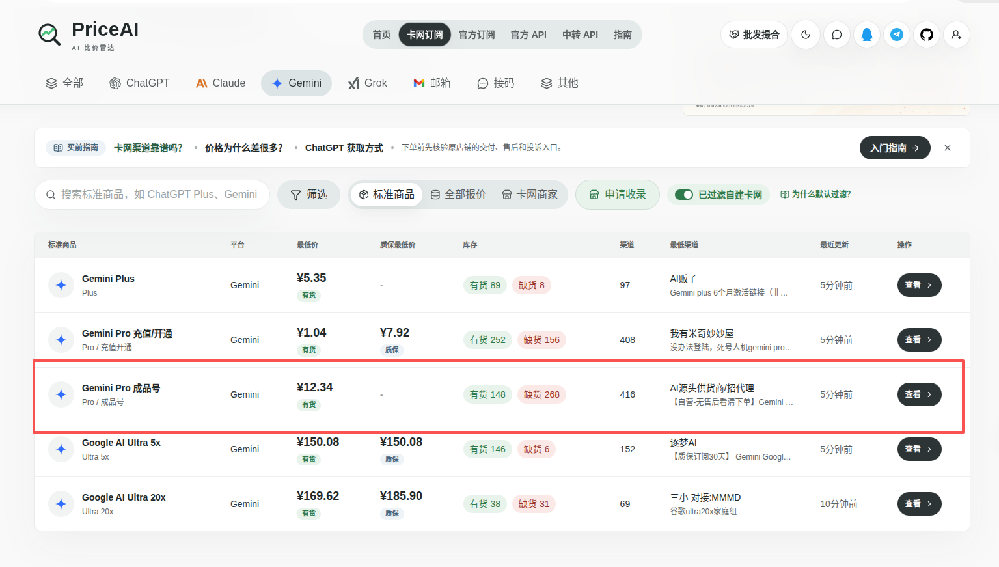
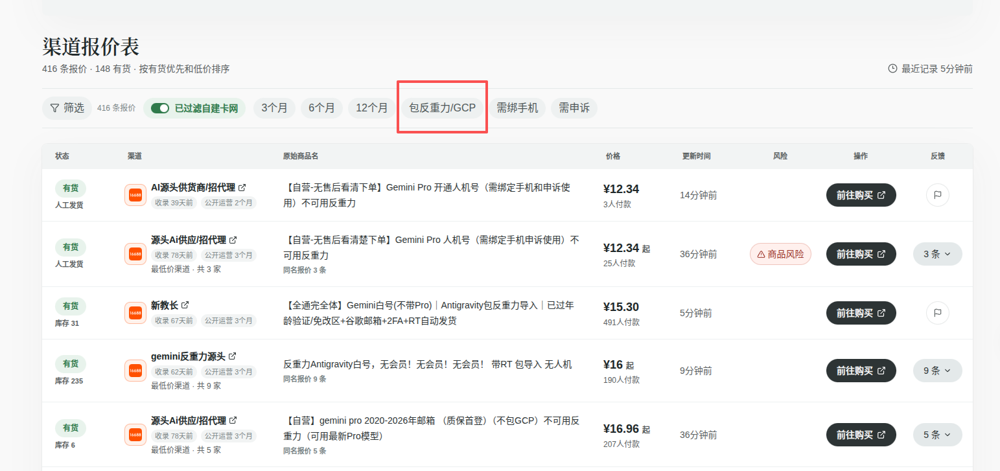
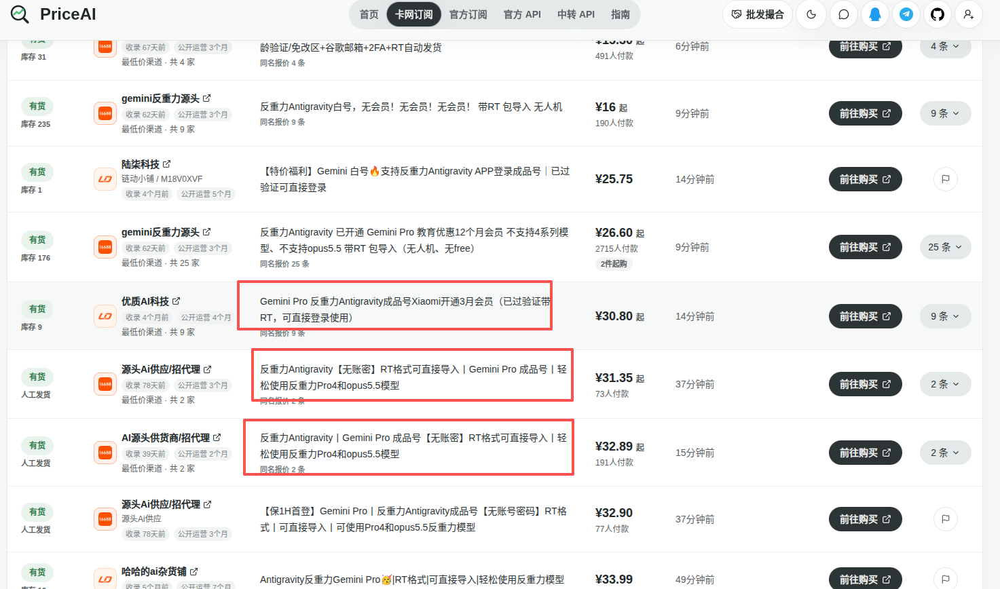

# GeminiPro账号购买

## 一、Gemini Pro 账号来源

1. **jiojip**。来自 Google 与 Jio 的合作活动。 [Google 活动公告](https://blog.google/company-news/inside-google/around-the-globe/google-asia/reliance-jio-india-partnership/)
2. **pexife**。可能指 Pixel 设备活动。符合条件的设备试用可在反重力使用部分 Gemini 4 模型。**需要 Gemini 4，优先看第二类。** [Antigravity 模型权限表](https://antigravity.google/docs/models#reasoning-model)

## 二、在 PriceAI 查看卡网报价

### 第一步 找到 Gemini Pro 成品号

打开 PriceAI 的 Gemini 比价页，找到 **Gemini Pro 成品号**，点击右侧的 **查看**。 [PriceAI Gemini 比价页](https://priceai.cc/channels?platform=Gemini)



### 第二步 筛选包反重力/GCP

进入「渠道报价表」后，点击 **包反重力/GCP**。



### 第三步 核对模型和报价

查看标明支持 **反重力（Antigravity）** 和 **Gemini 4** 的成品号。截图中标称可用「Pro4」的报价示例为 **¥31.35 起**和 **¥32.89 起**。



## 三、交付字段和 RT

交付示例（已脱敏）

```text
P***@gmail.com----********----i***@s***.us----********---1//********
```

前四段是 Google 登录和验证资料，最后一段是 **RT（Refresh Token，OAuth 刷新令牌）**。

[返回第三章](./README.md) · [前往第四章：反代](../04-reverse-proxy/README.md)
