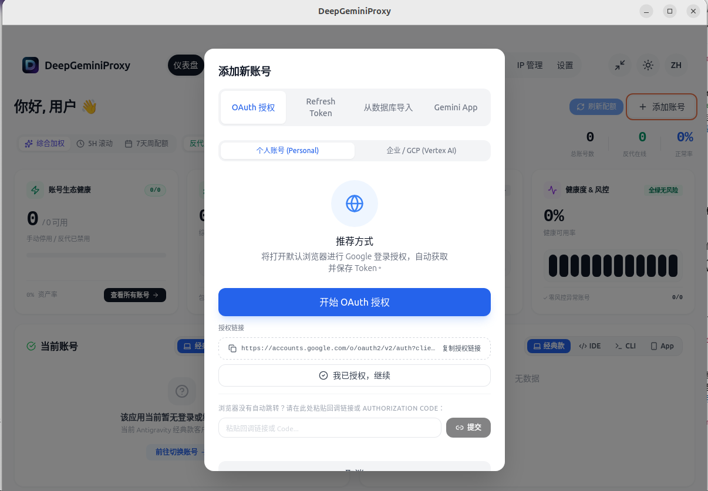
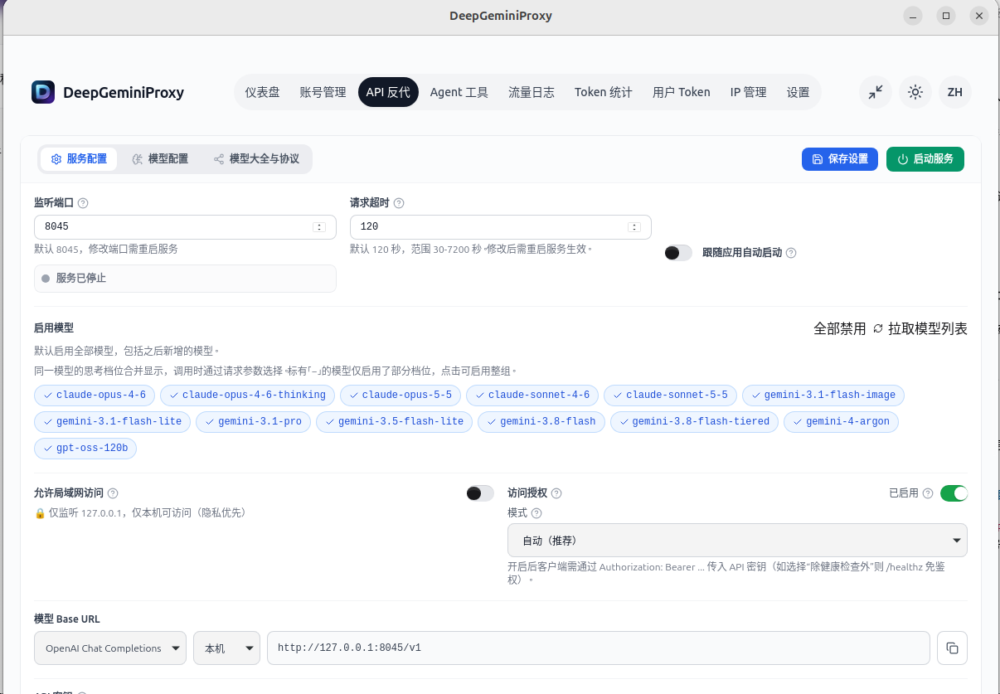
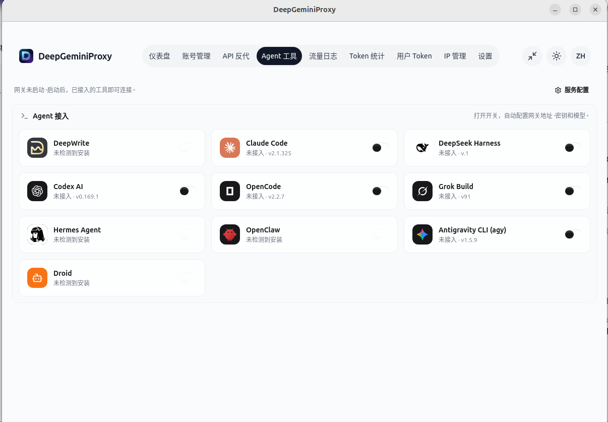

# 第四章 DeepGeminiProxy 反代教程

本篇介绍 DeepGeminiProxy 的下载安装、账号添加、API 反代启动，以及通过 Agent 工具开启接入的方法。

## 第一步 下载并安装

打开 [DeepGeminiProxy 项目仓库](https://github.com/swjybky/DeepGeminiProxy)，进入 [Releases 下载页](https://github.com/swjybky/DeepGeminiProxy/releases)，选择适合自己操作系统和 CPU 架构的安装包，下载、安装并打开软件。

- **Windows**：选择 Windows 安装包（`.exe` 或 `.msi`）。
- **macOS**：选择 `.dmg`，注意区分 Apple Silicon 和 Intel。
- **Linux**：按发行版选择 `.deb`、`.rpm` 或 `.AppImage`。

具体提供哪些安装包，以所选版本的 **Assets** 列表为准。

也可以把下面这段话发给能操作电脑的 AI，让它帮你下载安装：

```text
请帮我下载安装 DeepGeminiProxy：
https://github.com/swjybky/DeepGeminiProxy
请识别我电脑的操作系统和 CPU 架构，从这个仓库的 Releases 下载匹配的 DeepGeminiProxy 安装包，完成安装并打开软件。
```

## 第二步 在首页添加账号

打开软件后，点击首页右上角的 **＋ 添加账号**，会出现“添加新账号”窗口。



根据手头的账号资料选择添加方式：

| 账号资料 | 选择的入口 | 操作方式 |
| --- | --- | --- |
| 自己的 Google 账号，可以在浏览器登录 | 第一个标签 **OAuth 授权** | 点击“开始 OAuth 授权”，在浏览器中登录并完成授权 |
| 已有 Refresh Token（RT），例如购买账号后拿到的 RT | 第二个标签 **Refresh Token** | 将 RT 填入对应输入框，按页面提示添加账号 |
| 已有账号数据库或导出备份 | **从数据库导入**或页面提供的导入入口 | 选择软件支持的数据文件，按提示导入自己的账号 |

### 自己的账号：OAuth 授权

1. 选择 **OAuth 授权**；个人账号选择 **个人账号（Personal）**。
2. 点击 **开始 OAuth 授权**，在打开的浏览器里登录要添加的 Google 账号并完成授权。
3. 回到软件，等待账号自动保存。如果没有自动完成，点击 **我已授权，继续**。
4. 如果浏览器没有自动跳转，可按窗口提示粘贴回调链接或 Authorization Code，再点击 **提交**。

### 购买的账号：选择第二个标签

**购买后拿到 Refresh Token 的账号，选择第二个标签「Refresh Token」。** RT 就是 Refresh Token（刷新令牌），把它填到软件的对应位置，再按提示完成添加。

如果卖家只提供了邮箱和密码，需要先确认交付资料；邮箱密码不能直接填进 Refresh Token 输入框。

添加完成后，回到首页或账号列表，确认账号已经出现，并检查额度和状态。Refresh Token 属于账号凭据，不要放进公开截图、教程或聊天记录里。

## 第三步 选择模型并启动 API 反代

1. 点击顶部的 **API 反代**，进入 **服务配置** 页面。
2. 点击“启用模型”区域右侧的 **拉取模型列表**，刷新可用模型。
3. 在模型列表中选择你要使用的模型，保留需要启用的模型。
4. 点击右上角的 **启动服务**。服务启动后，反代就已经开始运行。



## 第四步 在 Agent 工具中开启接入

点击顶部的 **Agent 工具**，找到你要接入的工具，打开对应的开关即可。

接入 DeepWrite（DW）时，找到 **DeepWrite** 卡片，打开右侧开关。



## 第五步 在 DW 查看自定义模型

开启接入后，打开 **DeepWrite（DW）**，进入 **设置 → 自定义模型**，查看接入的模型即可。

安装包与功能说明可查阅 [DeepGeminiProxy 项目文档](https://github.com/swjybky/DeepGeminiProxy/blob/main/README_ZH.md)。本文截图由用户提供，按钮以实际安装版本为准。

---

[返回第四章](./README.md) · [返回总览](../README.md) · [前往第五章](../05-integration/README.md)
