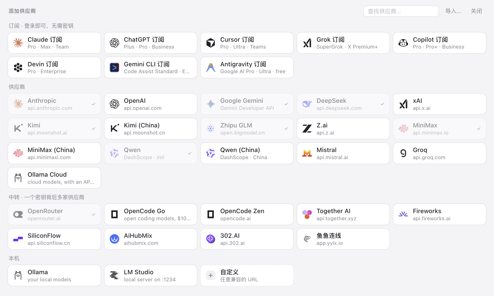
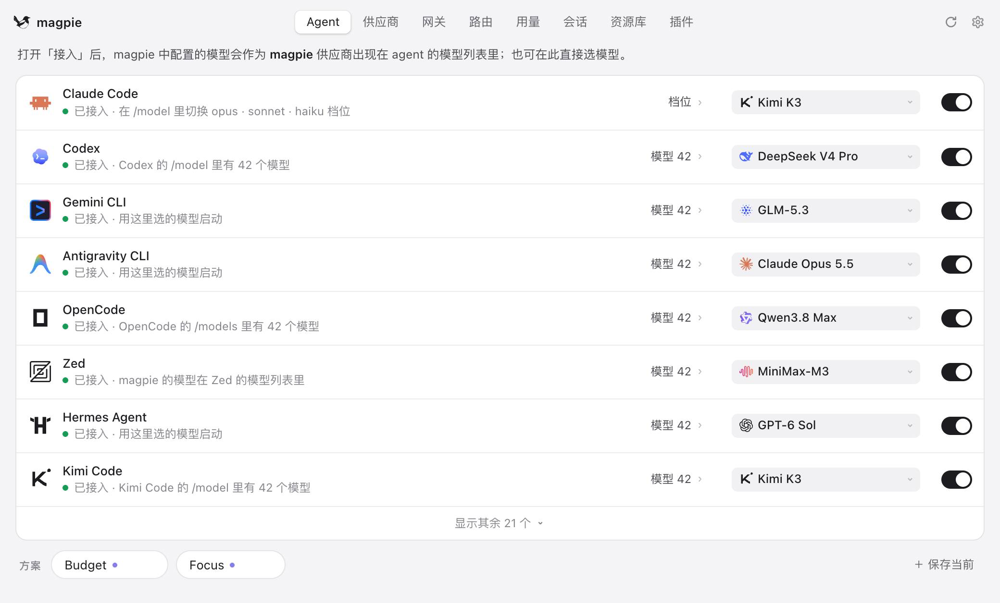
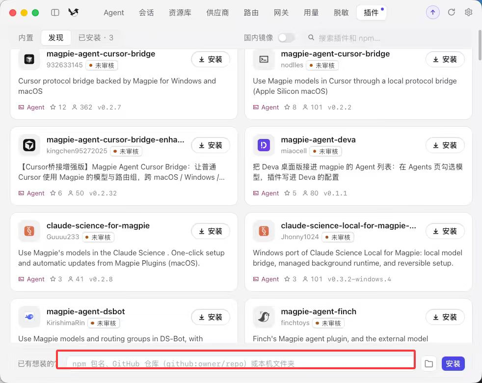
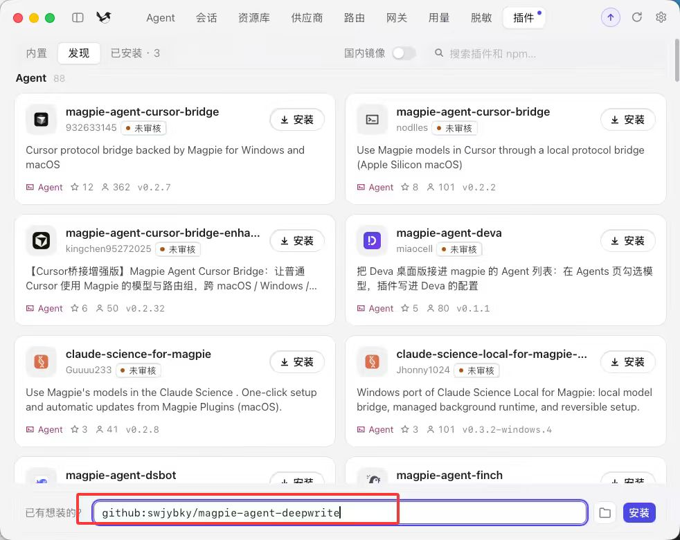
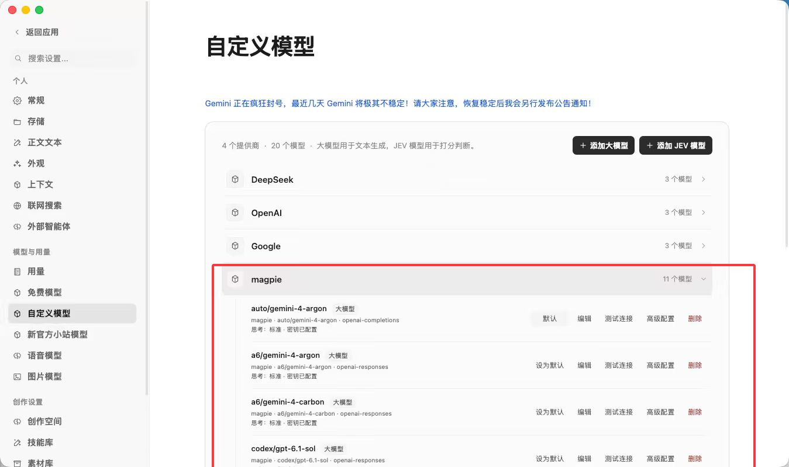

# 第四章 Magpie 反代与 DeepWrite 接入

把 Gemini API 添加到 Magpie 后，Codex、Claude Code 和 DeepWrite（DW）都可以通过同一个本机网关使用模型。启用 DeepWrite 插件后，后续增删模型在 Magpie 里操作即可，插件会更新 DW 的模型列表。

## 准备两样东西

1. **Magpie。** 从官网选择与你的系统匹配的桌面版，安装并打开。使用经 Magpie 接入的模型时，让 Magpie 在后台运行。 [Magpie 官方网站](https://usemagpie.ai/zh/) · [官方发布页](https://github.com/yetone/magpie/releases)
2. **DeepWrite 接入插件（可选）。** DeepWrite 的一键接入用的是 Magpie 的 Agent 插件入口。我开发的 `magpie-agent-deepwrite` 插件安装在 Magpie 里，负责把模型同步到 DW。想手动配置时，可以直接使用第二步的网关参数。 [插件 GitHub 仓库](https://github.com/swjybky/magpie-agent-deepwrite)

### 手头已有 Antigravity RT 时

RT（Refresh Token）是关联原 Google 账号授权的刷新令牌。浏览器里的 Google 登录与应用的 OAuth 授权分别管理。Google 将第三方工具使用 Antigravity OAuth 访问服务视为违约，可能暂停或终止相关服务。本教程使用 Google 为第三方接入推荐的 Gemini API Key，模型、额度和计费以 AI Studio 项目为准。 [Antigravity 服务条款](https://antigravity.google/terms) · [Google Antigravity 常见问题](https://antigravity.google/docs/faq) · [Gemini API 计费文档](https://aistudio.google.com/docs/billing)

如果 RT 已经贴进聊天或发给他人，请把它视为已泄露。若它关联你自己的账号，请检查 Google 账号里的应用授权并撤销相关访问。 [Google 账号的应用授权管理](https://support.google.com/accounts/answer/13533235?hl=zh-Hans)

## 第一步 添加供应商

1. **打开供应商页面。** 点击 Magpie 顶部的 **供应商**，再点 **＋ 添加供应商**。
2. **选择 Google Gemini。** 在 **供应商** 分组找到 **Google Gemini（Gemini Developer API）**。如果已经添加过，可以从供应商列表直接打开它。

   

3. **填写 API Key 并保存。** 在 Google AI Studio 里为自己的项目创建 Gemini API Key，将密钥填入 Magpie 并保存。展开该供应商，勾选要使用的模型，然后点击 **测试**。模型能通过测试后，就可以接到客户端。 [创建 Gemini API Key](https://aistudio.google.com/apikey) · [Magpie 的 Gemini 接入指南](https://usemagpie.ai/docs/gemini)

## 第二步 选择接入方式

### 方式一 手动填写网关参数

打开 Magpie 的 **网关**，确认状态为 **运行中**，然后找到 **接入** 区域。客户端要求哪种协议，就选择对应的 **OpenAI**、**Responses**、**Anthropic** 或 **Gemini** 标签，再复制该标签下的 **Base URL**、**API 密钥**和**模型 ID**。同一台电脑上使用时选 **本机**，模型 ID 保留 `google/` 等供应商前缀。 [Magpie 网关接入文档](https://usemagpie.ai/docs/integrate)

想手动接入 DW，可以在 **设置 → 自定义模型 → 添加大模型** 新建提供商 `magpie`，将 **API 类型**选为 **OpenAI Completions**（`openai-completions`）。**API 地址**填网关 **OpenAI** 标签页显示的 Base URL，默认是 `http://127.0.0.1:3425/v1`。填上 Magpie 网关密钥和完整模型 ID，测试后保存。

### 方式二 在 Agent 页一键接入（推荐）

1. 打开 Magpie 的 **Agent** 页，找到本机已安装的 Codex、Claude Code 或其他受支持的工具，打开那一行右侧的 **接入** 开关。
2. 在同一行的模型菜单选择所需的 Magpie 模型。使用 Codex 时，重启 Codex 并开启新会话，再从模型选择器里确认。 [Magpie 的 Codex 接入指南](https://usemagpie.ai/docs/codex-models)



## 第三步 在 DeepWrite 自动同步模型

### 安装 DeepWrite 插件

打开 Magpie 顶部的 **插件 → 发现**，找到页面底部的安装输入框。



粘贴下面的 GitHub 地址，点击输入框右侧的 **安装**。

```text
github:swjybky/magpie-agent-deepwrite
```



### 在 Agent 页开启接入

1. 先启动过一次 DeepWrite，让它生成本地配置。Linux 首次接入时，先按上面的手动配置方式保存一个提供商名为 `magpie` 的模型，并填写非空的密钥。Windows 使用插件 `v0.2.2` 或更新版本。 [插件安装与各系统的要求](https://github.com/swjybky/magpie-agent-deepwrite#安装更新与使用)
2. 完全退出 DeepWrite，回到 Magpie 的 **Agent** 页，找到 **DeepWrite**，打开右侧开关。看到 **已接入** 后，稍等片刻让插件写入配置。有模型范围菜单时，可以在这里调整同步到 DW 的模型。
3. 重新打开 DeepWrite。进入 **设置 → 自定义模型**，展开 **magpie** 分组，找到要用的 Gemini 模型，点 **测试连接**。测试通过后，在写作界面的模型选择器里选中该模型，发一条简短消息确认能收到回复。



截图里的模型名和数量是界面示例，以你同步后的列表为准。

以后在 Magpie 新增、移除模型或调整可见范围，插件会更新 DW 的 `magpie` 分组。Magpie 提供给 DeepWrite 的模型都会同步，平时在 Magpie 维护这一份列表即可。已打开的 DW 如果还显示旧列表，重开一次即可检查更新结果。 [插件同步说明](https://github.com/swjybky/magpie-agent-deepwrite#同步范围与恢复)

---

供应商面板及 Agent 页面截图来自 Magpie 的官方文档。 [Magpie 快速上手](https://usemagpie.ai/docs/zh/start)

[返回第四章](./README.md) · [返回总览](../README.md) · [前往第五章](../05-integration/README.md)
